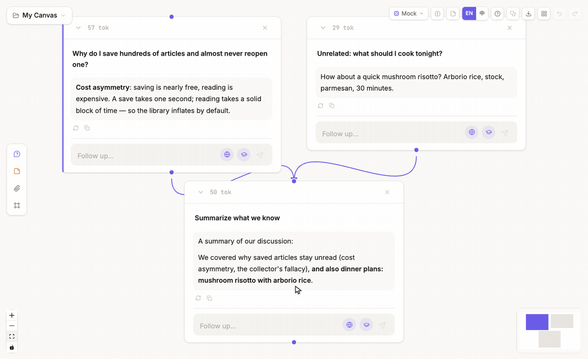

# Control context

For a worked example, follow [How to edit AI context while keeping past conversations](/tutorials/edit-ai-context).

## Inspect the next request

Before a follow-up, click the **“will send ~… tok · … messages”** summary line above the input in the [node panel](/guides/conversations#floating-panel-areas). The expanded preview lists the request in the order the model reads it:

- system additions (current date, answer language, what the markers mean, plus citation rules when the model is given search tools)
- the role
- materials
- explicit references
- conversation turns
- memory
- what is still in the input box (@-mentions, a selected passage, staged files)
- with recall on, a row says recall searches at send time

Click a row for its full text; the footer copies the whole request. The preview and the request are compiled by the same code and match message for message. It previews the next panel follow-up; it is not a separate canvas menu.

## See what an answer version read

Every answer version keeps the request it was generated from. Click the scroll icon under the answer ("What it read") to see each row of that request; rows that no longer match what the node would read today are marked "Changed since". Receipts stay in this browser and are not part of exports or shares; versions generated before the 'What it read' receipt feature have none.

## Create a context path or reference

- Drag from a node handle to empty canvas space to continue with a new question on the structural path.
- Drag from a node handle to an existing node to add an explicit reference.
- Use an `@` mention in an ask box to reference a named node.

Solid wires carry the full upstream conversation path. A purple dashed summary reference carries the referenced node's question and answer plus the upstream question trail, without importing every upstream answer.

## Change what enters the request

- **Delete a wire** to remove that route while leaving both nodes on the canvas.
- **Move a wire** by dragging either end onto another node's handle. A solid wire that would close a cycle, a wire onto a material or frame, a wire branched from selected text, and a pair that is already connected are refused.
- **Insert a step**: right-click a solid wire between two turns, choose "Insert a step here" and type the question; the downstream turn then continues from the new step and is marked stale.
- **Archive a node** to keep it stored but exclude it from traversal. Deleting a middle step takes its downstream with it; the notice offers to undo and archive just that step.
- Select a convertible wire to switch between **full structural context** and a **summary reference**. The wire action shows an estimated token difference.

## Verify the effect

After changing a wire, use the same question and model to regenerate, then [compare the previous and new answer versions](/guides/versions-replay#compare-answer-versions). This separates a context intervention from a prompt or model change.

Deleting a wire is not deleting a node: the excluded work remains visible, inspectable, and available to reconnect elsewhere.
