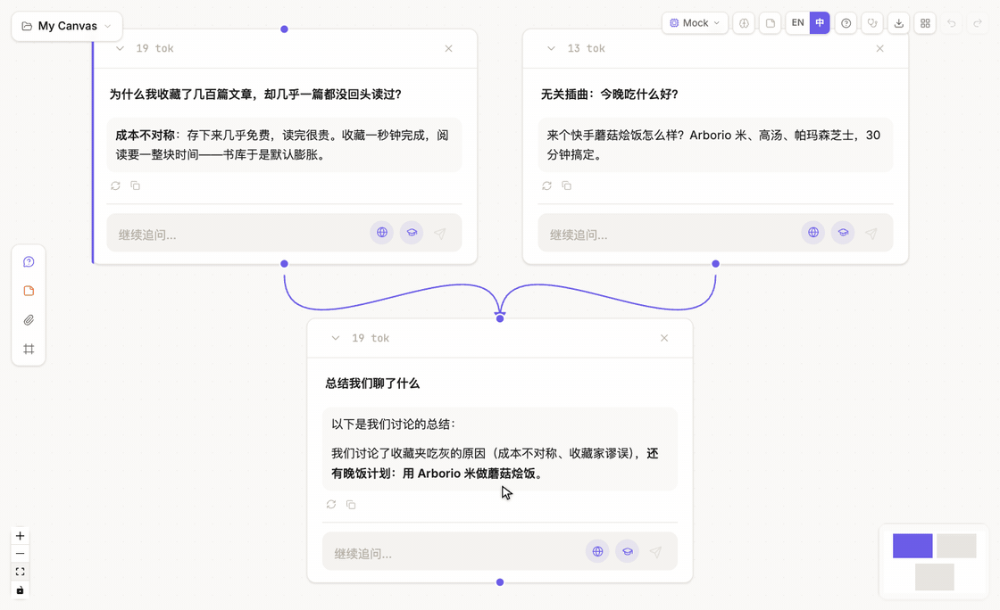

# 控制上下文

想跟着具体例子操作，先看[如何编辑 AI 上下文，同时保留已经聊过的内容](/zh/tutorials/edit-ai-context)。

## 检查下一次请求

继续追问前，点击[节点侧栏](/zh/guides/conversations#浮动侧栏的功能区)输入框上方的 **“将发送约 … tok · … 条消息”** 摘要行。展开的预览按模型读到的顺序逐条列出这次请求：

- 系统附加（当前日期、回答语言、标记说明；模型拿到搜索工具时再加一段引用规则）
- 角色
- 材料
- 显式引用
- 对话轮次
- 记忆
- 输入框里还没发出的 @ 提及、选段和附件

开着回忆时会额外多一条“发送时检索”。点一条看全文，底部可以复制整份请求。预览与实际请求走同一套编译，逐条一致。它只预览侧栏中的下一次追问，不是独立的画布菜单。

## 回看一版回答读到了什么

每一版回答都保存了生成时发出的完整请求。点回答下方的纸卷图标（悬停显示"当时读到了什么"），可以看到那次请求的每一条；和这个节点现在会读到的内容不一样的条目标为"现已不同"。这些记录只保存在本机浏览器里，导出和分享不包含它们；**在这个功能上线之前生成的版本没有回执**。

## 建立上下文路径或引用

- 从节点连接点拖到画布空白处，沿结构路径继续提出新问题；
- 从节点连接点拖到已有节点，加入显式引用；
- 在输入框中使用 `@` 提及一个已命名节点。

实线会携带完整的上游对话路径。紫色虚线的摘要引用会带入指定节点的问答和上游问题线索，但不会把每个上游回答都加入请求。

## 改变进入请求的内容

- **删除连线**：移除这条上下文路线，但保留两端节点；
- **改接连线**：拖动连线的任一端，放到另一个节点的连接点上。以下情况会被拒绝：
  - 会成环的实线；
  - 指向材料或框架的线；
  - 从选中文字分出的线；
  - 两端已经相连的情况。
- **插入一步**：在两轮对话之间的实线上右键，选"在中间插入一步"，输入问题；原来的下游改为接在新的一步后面，并标为"上游已变"；
- **归档节点**：保留内容，但把它排除在遍历之外。删除中间的节点会连同下游一起删除，提示里可以撤销并改为只归档这一步；
- 选中可转换的连线，在**完整结构上下文**与**摘要引用**之间转换。连线操作会显示估算 token 差异。

## 验证变化

改变连线后，使用同一个问题和模型重新生成，再[比较前后回答版本](/zh/guides/versions-replay#比较回答版本)。这样可以把上下文干预与提示词或模型变化区分开。

删除连线不等于删除节点：被排除的工作仍留在画布上，可以检查，也可以重新连接到其他位置。
